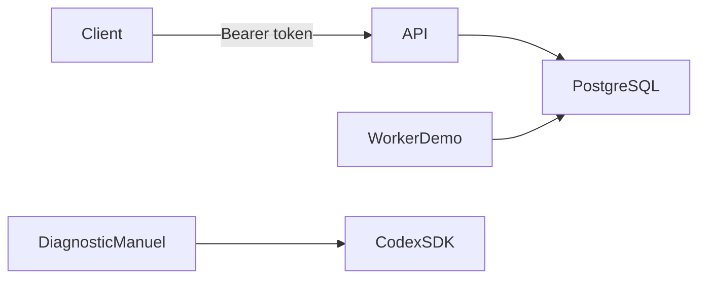

# Architecture du premier jalon

## Périmètre

Le contrôleur reçoit des tâches via une API authentifiée. PostgreSQL conserve leur état et leurs événements. Un processus indépendant traite la file en mode **demo**. Le résultat indique explicitement qu'aucun modèle n'a été appelé et qu'aucun code n'a été modifié.

Le schéma SQL autorise uniquement `mode = 'demo'`. La clé OpenAI est absente de Docker Compose. Le SDK est utilisé uniquement par un diagnostic manuel distinct.

## États et réservations

`ready → running → result_ready`. Une tâche prête, en cours ou bloquée peut devenir `cancelled`. Une réservation expirée devient `blocked` : l'état réel doit être rapproché avant d'ajouter une reprise automatique capable de modifier du code.

La réservation utilise `FOR UPDATE SKIP LOCKED`. Chaque réservation reçoit un jeton UUID privé. Un heartbeat ou un résultat n'est accepté que si ce jeton correspond toujours à une réservation active et non expirée. Annuler une tâche invalide immédiatement le jeton. Le worker de démonstration termine aussitôt ; les exécuteurs longs futurs devront renouveler leur bail et interrompre leurs outils s'ils le perdent.

Une clé d'idempotence stable est obligatoire à la création. Réutiliser cette clé avec le même contenu renvoie la tâche existante ; un contenu différent provoque HTTP 409. Les mises à jour et leurs événements sont dans la même transaction.

Ces garanties concernent PostgreSQL. Elles ne prétendent pas fournir une exécution « exactement une fois » d'effets externes. La création de branches, commits et PR devra employer des identifiants stables et un rapprochement après panne.

## Accès et déploiement

API liée à 127.0.0.1:3000 sur l'hôte ; PostgreSQL n'a pas de port publié. `/healthz` et `/readyz` ne donnent que l'état de santé. Toutes les routes `/v1` exigent le token. Les jetons de réservation et empreintes internes ne sont jamais sérialisés par l'API.

Les conteneurs applicatifs tournent avec l'utilisateur `node`, un système de fichiers en lecture seule, des limites de ressources et sans privilèges supplémentaires. L'administrateur Docker conserve un accès aux secrets d'environnement : ce périmètre d'administration est de confiance.

Le futur exécuteur réel utilisera un environnement isolé, un accès API intermédiaire borné et des identifiants Git séparés pour la publication. Le worker actuel n'est pas une sandbox de code non fiable.

## Limites actuelles

- Une API de tâches et une démonstration persistante sont disponibles ; interface web, GitHub App, import d'issues, écriture de code et publication restent à construire.
- Le coût API du mode demo est zéro. Les plafonds de dépense et le calcul des coûts réels ne sont pas implémentés ; le diagnostic manuel utilise la facturation du compte API et n'a qu'une limite de durée.
- Les tâches expirées sont bloquées, jamais relancées automatiquement. L'annulation empêche l'enregistrement d'un résultat ; l'arrêt de processus externes devra être ajouté au futur exécuteur.
- Le heartbeat de l'exécuteur futur et sa supervision doivent être intégrés avant des travaux longs.
- Les migrations sont sérialisées et vérifiées par empreinte. Les images Docker utilisent des tags de versions majeures, à verrouiller par digest avant une installation durable.
- L'API est destinée à un utilisateur sur un réseau privé. Quotas, politique de rétention, sauvegardes automatisées et supervision externe restent à configurer.
